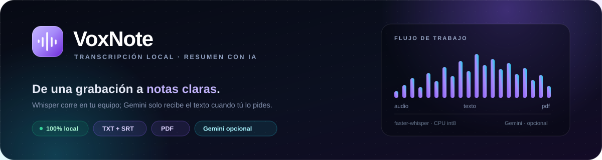
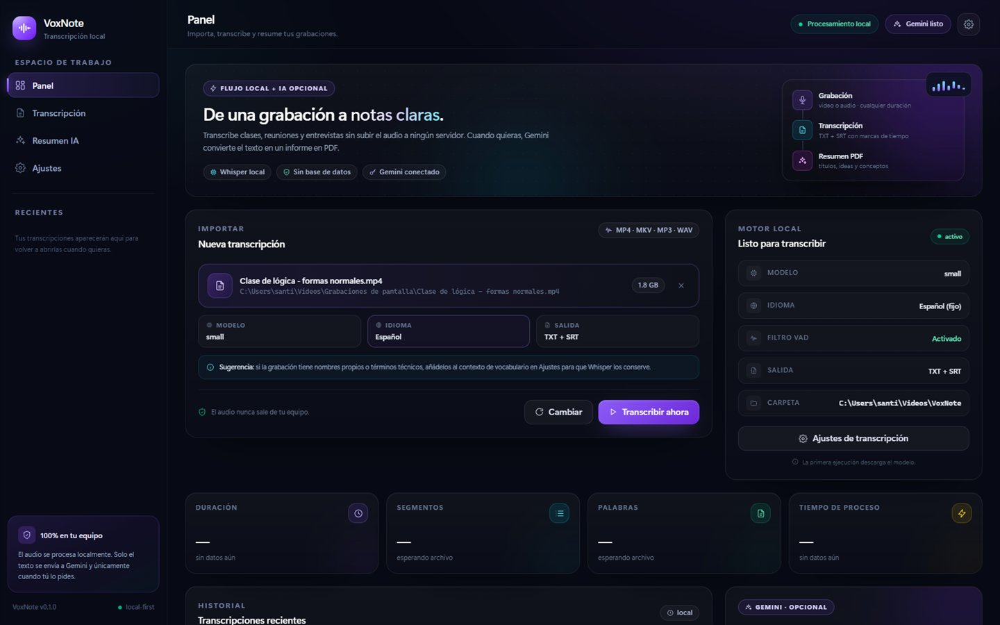
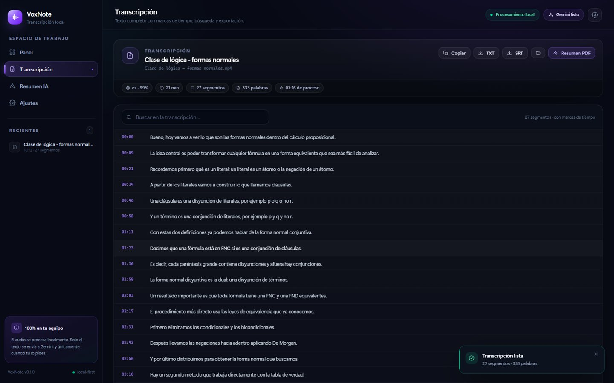
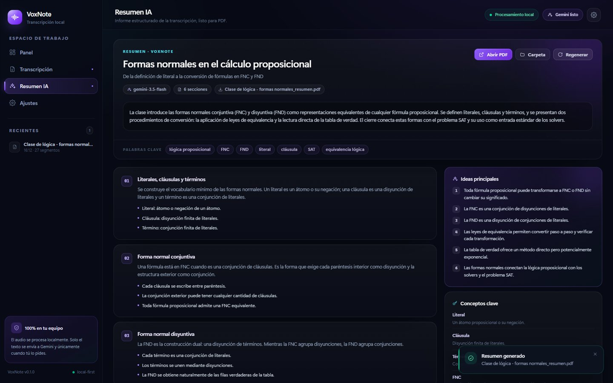
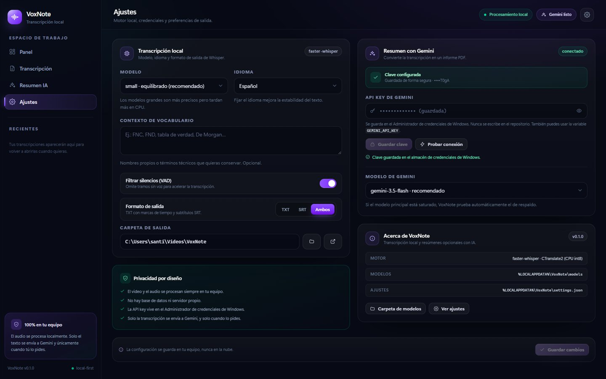
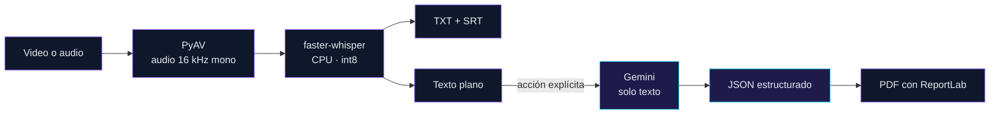

<p align="center">
  
</p>

<h1 align="center">VoxNote</h1>

<p align="center">
  <b>Transcribe videos y audios sin subir nada a la nube.</b><br>
  Whisper en tu equipo · TXT con marcas de tiempo · SRT · resumen en PDF con Gemini cuando tú lo pides.
</p>

<p align="center">
  
  
  
  
  
  
  
  <a href="https://github.com/santiago1891-crypto/VoxNote/releases/download/v0.1.1/VoxNote.exe"></a>
</p>

<p align="center">
  
  
  
  
  
  
</p>

<p align="center">
  
  
  
  
  
  
</p>

<p align="center">
  <a href="#qué-es-voxnote">Descripción</a> ·
  <a href="#vista-previa">Capturas</a> ·
  <a href="#características">Características</a> ·
  <a href="#cómo-funciona">Cómo funciona</a> ·
  <a href="#stack-tecnológico">Stack</a> ·
  <a href="#descarga-y-ejecutable">Descarga</a> ·
  <a href="#instalación">Instalación</a> ·
  <a href="#uso">Uso</a> ·
  <a href="#configuración">Configuración</a> ·
  <a href="#privacidad">Privacidad</a> ·
  <a href="#solución-de-problemas">Problemas</a>
</p>

---

## ¿Qué es VoxNote?

VoxNote es una aplicación de escritorio para **transcribir videos y audios de forma local** y, si quieres, convertir la transcripción en un **informe en PDF** con títulos, ideas clave, conceptos y conclusiones.

El audio y el video **nunca salen del equipo**: la transcripción corre con `faster-whisper` sobre CPU. Solo el texto se envía a Gemini, y únicamente después de pulsar **Generar resumen**. El PDF se maqueta localmente con ReportLab, así que el diseño no depende de servicios externos.

Está pensada para clases grabadas, reuniones, entrevistas y cualquier grabación larga que no quieras subir a una plataforma. No usa base de datos, no tiene telemetría ni servidor de aplicación.


## Vista previa

| Panel | Transcripción |
|:---:|:---:|
|  |  |

| Resumen IA | Ajustes |
|:---:|:---:|
|  |  |

<sub>Capturas con datos de demostración. La interfaz se adapta a la ventana y conserva el historial local.</sub>

## Características

- **Transcripción 100 % local** con `faster-whisper` y CTranslate2 en CPU (int8). Sin GPU ni FFmpeg externo.
- **Conversaciones con varias voces y ruido de fondo**: Whisper transcribe intervenciones solapadas y el VAD filtra silencios; no etiqueta hablantes.
- **Cualquier formato habitual**: MP4, MKV, AVI, MOV, WEBM, MP3, WAV, M4A, AAC, FLAC y OGG.
- **TXT con marcas de tiempo** por segmento y **subtítulos SRT** listos para editar.
- **Búsqueda dentro de la transcripción**, copia al portapapeles y exportación desde la interfaz.
- **Historial local** de las últimas transcripciones para volver a abrirlas sin volver a procesar el archivo.
- **Resumen estructurado con Gemini**: título, subtítulo, panorama, secciones con viñetas, ideas principales, conceptos, conclusiones y palabras clave.
- **PDF con diseño propio**: títulos en violeta, barras de sección, tabla de conceptos y numeración de páginas.
- **Privacidad por diseño**: la API key vive en el Administrador de credenciales de Windows; el repositorio nunca la contiene.
- **Cancelación y progreso en segundo plano**: puedes cambiar de vista mientras se transcribe.
- **CLI y eventos NDJSON** para automatizar el flujo sin abrir la interfaz.
- **Configurable**: modelo de Whisper, idioma, filtro VAD, contexto de vocabulario, formato de salida, carpeta y modelo de Gemini.

## Cómo funciona



1. **Inspección y decodificación.** PyAV detecta la duración y decodifica el audio a `float32`, mono, 16 kHz. Si el archivo no tiene pista de audio, se detiene con un error claro.
2. **Transcripción.** `faster-whisper` procesa el audio en CPU con el modelo elegido. El progreso se emite por segmentos y puede cancelarse.
3. **Exportación local.** Se escriben el TXT con marcas de tiempo y el SRT en la carpeta de salida.
4. **Resumen opcional.** Al pulsar el botón, solo el texto viaja a Gemini. La respuesta JSON se normaliza y se maqueta como PDF en el equipo.

> Todo lo que está en violeta ocurre en tu equipo. La nube solo participa en el paso marcado como **acción explícita** y recibe texto, nunca audio ni video.

## Stack tecnológico

| Capa | Tecnología | Uso |
|---|---|---|
| Interfaz | **React 19 + TypeScript 5.9** | Dashboard, transcripción, resumen y ajustes |
| Estilos | **Tailwind CSS 4** + CSS propio | Tema oscuro violeta, componentes y animaciones |
| Build | **Vite 7** | Desarrollo con recarga y build de producción |
| Ventana | **pywebview 6.2 + WebView2** | Contenedor nativo en Windows, sin Electron ni Tauri |
| Puente | API JS de pywebview | Llamadas a Python y eventos `window.voxnoteEmit` |
| Audio | **PyAV 19 + NumPy** | Decodificación con FFmpeg embebido, sin instalarlo aparte |
| Transcripción | **faster-whisper 1.2 + CTranslate2 4.8** | Inferencia local en CPU con cuantización int8 |
| IA | **Gemini REST** (`urllib`, sin SDK) | Resumen estructurado en JSON |
| PDF | **ReportLab 4** | Maquetación local del informe |
| Credenciales | **keyring** | Administrador de credenciales de Windows |
| Empaquetado | **PyInstaller 6.22** | Un único `VoxNote.exe` con Python y la interfaz |
| Pruebas | **pytest** | Backend, exportación, PDF y ajustes del escritorio |


## Requisitos

**Para usar el ejecutable**

- **Windows 10 u 11** (x64). La interfaz usa WebView2; en Windows 11 viene instalado y en Windows 10 puede requerir el [runtime Evergreen](https://developer.microsoft.com/microsoft-edge/webview2/).
- **Entre 75 MB y 3 GB de disco** para el modelo de Whisper elegido (el ejecutable ocupa unos 104 MB).
- **Internet** la primera vez (descarga del modelo) y para generar resúmenes con Gemini.
- **No hace falta Python, Node, FFmpeg ni GPU.**

**Para compilar o ejecutar desde el código**

- **Python 3.10 o superior** (probado con 3.14).
- **Node.js 20.19+ o 22.12+** solo para compilar la interfaz (Vite 7).
- **~1 GB de disco** para dependencias y el entorno virtual.
- **8 GB de RAM recomendados**; los modelos grandes necesitan más.
- **No hace falta FFmpeg**: `faster-whisper` decodifica con PyAV, que trae FFmpeg embebido.
- **No hace falta GPU**: el flujo por defecto usa CPU con int8.

## Descarga y ejecutable

La app se distribuye como **un único `VoxNote.exe`** de unos **104 MB**. Incluye Python, el backend, la interfaz React compilada, las DLL de CTranslate2/PyAV y el modelo VAD; en el equipo de destino **no hay que instalar nada más**.

> **[Descargar VoxNote.exe v0.1.1](https://github.com/santiago1891-crypto/VoxNote/releases/download/v0.1.1/VoxNote.exe)**<br>
> [Todas las versiones](https://github.com/santiago1891-crypto/VoxNote/releases)

SHA-256 del ejecutable publicado:

```text
2e996bc36c8b3b205d6a5f23d0562b0ee503c3bd8db70438ac24b2a49f990978
```

Puedes comprobarlo con `certutil -hashfile .\VoxNote.exe SHA256`.

1. Guarda `VoxNote.exe` en una carpeta con permisos de escritura.
2. Ejecútalo. La primera vez descarga el modelo de Whisper (`small`, ~484 MB) en `%LOCALAPPDATA%\VoxNote\models`.
3. Si Windows SmartScreen avisa, elige **Más información → Ejecutar de todas formas**: el binario no está firmado.

El ejecutable es portable: no crea una instalación ni pide permisos de administrador. Al arrancar se descomprime en `%TEMP%` (por eso tarda unos segundos) y usa el WebView2 del sistema. Los ajustes, el historial y las transcripciones siguen guardándose en `%LOCALAPPDATA%\VoxNote` y en la carpeta de salida.

### Compilar el ejecutable

Requisitos: Python 3.10+, Node.js 20.19+/22.12+ y el repositorio clonado. Desde la raíz:

```powershell
powershell -ExecutionPolicy Bypass -File .\scripts\build_windows.ps1
```

El script compila la interfaz, instala PyInstaller y deja el resultado en `dist\VoxNote.exe`. Si React ya está compilado, puedes omitir ese paso:

```powershell
powershell -ExecutionPolicy Bypass -File .\scripts\build_windows.ps1 -SkipFrontend
```

También puedes invocar PyInstaller directamente:

```powershell
cd python
.\.venv\Scripts\python.exe -m pip install -r requirements-build.txt
cd ..
.\python\.venv\Scripts\python.exe -m PyInstaller --clean --noconfirm python\voxnote.spec
```

El spec incluye `frontend/dist`, los modelos ONNX del VAD de faster-whisper, las DLL de CTranslate2 y el icono. `dist/` y `build/` están ignorados por Git.

### Publicar una release

Con [GitHub CLI](https://cli.github.com/) autenticado:

```powershell
gh release create v0.1.1 .\dist\VoxNote.exe --title "VoxNote 0.1.1" --notes "Correcciones de estabilidad en transcripción, exportación y resumen."
```

> El ejecutable no está firmado. Para distribución pública conviene firmarlo con un certificado de código y así evitar el aviso de SmartScreen.

## Instalación

Para desarrollar o ejecutar sin empaquetar, clona el repositorio y ejecuta desde la raíz:

```powershell
cd python
python -m venv .venv
.\.venv\Scripts\python.exe -m pip install --upgrade pip
.\.venv\Scripts\python.exe -m pip install -r requirements.txt
.\.venv\Scripts\python.exe -m pip install -r requirements-dev.txt

cd ..\frontend
npm install
npm run build
```

> En PowerShell con la ejecución de scripts deshabilitada, usa `npm.cmd install` y `npm.cmd run build`.

El primer arranque descarga el modelo de Whisper a `%LOCALAPPDATA%\VoxNote\models`, fuera del repositorio. La interfaz compilada queda en `frontend\dist` (ignorada por Git).

## Uso

### Aplicación de escritorio

```powershell
cd python
.\.venv\Scripts\python.exe -m voxnote.desktop
```

Flujo habitual:

1. **Importar** un video o audio con el botón del panel.
2. Revisar **modelo, idioma y formato** (o cambiarlos en Ajustes).
3. Pulsar **Transcribir ahora** y seguir el progreso. Puedes cancelar o cambiar de vista.
4. Buscar, copiar o exportar el texto desde **Transcripción**.
5. Configurar la API key y pulsar **Resumen PDF** para generar el informe con Gemini.

### Desarrollo con recarga en caliente

```powershell
# Terminal 1
cd frontend
npm run dev

# Terminal 2
cd python
.\.venv\Scripts\python.exe -m voxnote.desktop --dev
```

Opciones del contenedor: `--dev` carga Vite en `http://localhost:5173`, `--url` permite otra URL y `--debug` abre las DevTools.

### Línea de comandos

El backend funciona sin interfaz:

```powershell
cd python

# Transcripción completa (TXT + SRT) en .\salida
.\.venv\Scripts\python.exe -m voxnote.cli "C:\ruta\video.mp4"

# Fragmento de 2 minutos a partir del minuto 4
.\.venv\Scripts\python.exe -m voxnote.cli "video.mp4" --start-minutes 4 --max-minutes 2 --force

# Transcripción + resumen PDF en una sola pasada
.\.venv\Scripts\python.exe -m voxnote.cli "video.mp4" --summary --gemini-model gemini-3.5-flash

# Resumen de una transcripción existente
.\.venv\Scripts\python.exe -m voxnote.summarize "salida\clase.txt" --out salida

# Eventos NDJSON por línea (integración)
.\.venv\Scripts\python.exe -m voxnote.cli "video.mp4" --json
```

| Opción | Descripción |
|---|---|
| `-m, --model` | `tiny`, `base`, `small` (defecto), `medium`, `large-v3`, `large-v3-turbo` |
| `-l, --lang` | Idioma del audio; `auto` para detectarlo (defecto: `es`) |
| `-o, --out` | Carpeta de salida (defecto: `.\salida`) |
| `--format` | `txt`, `srt` o `both` (defecto: `both`) |
| `--start-minutes` / `--max-minutes` | Procesar solo un fragmento |
| `--initial-prompt` | Glosario o contexto para orientar el vocabulario |
| `--no-vad` | Desactivar el filtro de silencios |
| `--cpu-threads` | Hilos de CPU; `0` = automático |
| `--summary` | Generar también el resumen en PDF |
| `--gemini-model` / `--gemini-key` | Modelo y clave de Gemini |
| `--force` | Sobrescribir archivos existentes |
| `--json` | Eventos NDJSON en stdout |

Más detalle del backend en [`python/README.md`](python/README.md).

## Archivos generados

Por defecto, los resultados van a `C:\Users\<usuario>\Videos\VoxNote` (configurable):

```text
VoxNote/
├── clase_de_logica.txt        # texto con marcas de tiempo
├── clase_de_logica.srt        # subtítulos SubRip
├── clase_de_logica_resumen.json
└── clase_de_logica_resumen.pdf
```

Ejemplo de TXT:

```text
[00:04:00] Vamos a comenzar. Hoy vamos a hablar sobre formas normales...
[00:04:14] ¿Qué entendemos por una forma normal?
[00:04:22] Recordemos primero qué es un literal: un átomo o su negación.
```

El SRT usa el formato estándar `HH:MM:SS,mmm` y puede importarse en cualquier editor de video. El JSON del resumen conserva la estructura completa por si quieres reutilizarla.

## Configuración

Los ajustes se guardan en `%LOCALAPPDATA%\VoxNote\settings.json`:

```json
{
  "model": "small",
  "language": "es",
  "vad": true,
  "formats": "both",
  "outputDir": "C:\\Users\\tu-usuario\\Videos\\VoxNote",
  "geminiModel": "gemini-3.5-flash",
  "initialPrompt": ""
}
```

| Campo | Valores | Descripción |
|---|---|---|
| `model` | `tiny` … `large-v3-turbo` | Modelo de Whisper |
| `language` | `es`, `en`, `pt`, `fr` o vacío | Idioma fijo; vacío = detección automática |
| `vad` | `true` / `false` | Filtrar silencios para acelerar |
| `formats` | `txt`, `srt`, `both` | Archivos de transcripción |
| `outputDir` | ruta absoluta | Carpeta de salida |
| `geminiModel` | modelo de Gemini | Modelo del resumen |
| `initialPrompt` | texto | Vocabulario o contexto opcional |

### Modelos de Whisper

| Modelo | Tamaño aprox. | Velocidad en CPU | Calidad | Recomendación |
|---|---:|---|---|---|
| `tiny` | 75 MB | Muy rápida | Básica | Pruebas rápidas |
| `base` | 145 MB | Rápida | Aceptable | Equipos modestos |
| `small` | 484 MB | Equilibrada | Buena | **Defecto recomendado** |
| `medium` | 1,5 GB | Lenta | Muy buena | Cuando la precisión importa |
| `large-v3` | 3,1 GB | Muy lenta | Excelente | Máxima calidad sin GPU |
| `large-v3-turbo` | 1,6 GB | Rápida | Muy buena | Buen equilibrio |

### Modelos de Gemini

| Modelo | Uso |
|---|---|
| `gemini-3.5-flash` | Principal por defecto |
| `gemini-3.1-flash-lite` | Respaldo automático si el principal falla o está saturado |

Si la transcripción supera los 400 000 caracteres, se resume por bloques de 100 000 antes de generar el informe final.

## API key y seguridad

La clave de Gemini **nunca** se escribe en el repositorio, en `settings.json` ni en los logs. Hay dos formas de configurarla:

1. **Desde la app:** *Ajustes → Resumen con Gemini → API key*. Se guarda en el Administrador de credenciales de Windows mediante `keyring`.
2. **Variable de entorno:** `GEMINI_API_KEY` o `GOOGLE_API_KEY`.

La interfaz solo muestra los últimos cuatro caracteres de la clave guardada. Si compartiste una clave en un chat, en un issue o en una captura, **revócala y genera una nueva** en [Google AI Studio](https://aistudio.google.com/app/apikey).

La clave se envía únicamente a la API de Gemini como parámetro de la petición HTTPS; el cliente no la registra en disco.

## Privacidad

| Dato | Dónde va |
|---|---|
| Video y audio | Solo tu equipo |
| Transcripción | Tu equipo; a Gemini solo si pides el resumen |
| API key | Administrador de credenciales de Windows |
| Ajustes | `%LOCALAPPDATA%\VoxNote\settings.json` |
| Historial de la interfaz | Almacenamiento local del WebView |

- Sin base de datos, sin servidor propio y sin telemetría.
- Sin cuentas: la app no pide registro.
- Los modelos se descargan una vez desde Hugging Face a `%LOCALAPPDATA%\VoxNote\models`.
- Las transcripciones se escriben solo en la carpeta que elijas.
- El historial son los últimos ocho trabajos y vive en el `localStorage` del WebView.
- pywebview sirve los archivos estáticos de la interfaz en `127.0.0.1:42001`; no expone la API a la red.
- El ejecutable único se descomprime en una carpeta temporal de `%TEMP%` mientras está abierto; Windows la elimina al cerrar.

## Pruebas

```powershell
cd python
.\.venv\Scripts\python.exe -m pytest
```

**33 pruebas** en verde. Cubren:

- Exportación TXT y SRT, marcas de tiempo y caracteres especiales.
- Inspección y decodificación de audio con PyAV.
- Errores con código estable, opciones de la CLI y protocolo NDJSON.
- Normalización de ajustes y rutas del escritorio.
- Estructura del resumen, extracción de JSON y renderizado del PDF.

Las pruebas no descargan modelos ni necesitan conexión a internet. El ejecutable empaquetado se verificó con una transcripción real de 35 segundos (17 eventos, TXT + SRT) y con la generación de un PDF de prueba. Para validar la interfaz:

```powershell
cd frontend
npm run build   # incluye tsc --noEmit
```

## Estructura del proyecto

```text
VoxNote/
├── assets/
│   ├── banner.svg              # banner del README
│   └── voxnote.ico             # icono del ejecutable y de la ventana
├── docs/
│   └── capturas/               # capturas para la documentación
├── frontend/                   # interfaz React + Vite + Tailwind
│   ├── src/
│   │   ├── components/
│   │   │   ├── Dashboard.tsx   # panel, importación y progreso
│   │   │   ├── TranscriptView.tsx
│   │   │   ├── SummaryView.tsx
│   │   │   ├── SettingsView.tsx
│   │   │   ├── Sidebar.tsx
│   │   │   ├── TopBar.tsx
│   │   │   └── ui/             # iconos y controles
│   │   ├── lib/
│   │   │   ├── bridge.ts       # puente pywebview + mock de navegador
│   │   │   └── format.ts
│   │   ├── App.tsx             # estado global y eventos
│   │   ├── index.css           # tema oscuro violeta
│   │   └── types.ts
│   ├── index.html
│   ├── vite.config.ts
│   └── dist/                   # build que carga la ventana (ignorado)
├── python/
│   ├── voxnote/
│   │   ├── desktop.py          # ventana pywebview y API para React
│   │   ├── cli.py              # transcripción por terminal
│   │   ├── summarize.py        # resumen por terminal
│   │   ├── pipeline.py         # orquestación reutilizable
│   │   ├── media.py            # inspección y decodificación con PyAV
│   │   ├── transcribe.py       # wrapper de faster-whisper
│   │   ├── export.py           # TXT y SRT
│   │   ├── credentials.py      # keyring / variables de entorno
│   │   ├── report.py           # reporter de consola y NDJSON
│   │   ├── errors.py           # errores con código estable
│   │   └── ai/
│   │       ├── gemini.py       # cliente REST de Gemini
│   │       ├── prompts.py      # plantillas del resumen
│   │       ├── pdf.py          # maquetación con ReportLab
│   │       └── service.py      # resumen + JSON + PDF
│   ├── voxnote_launcher.py     # punto de entrada del ejecutable
│   ├── voxnote.spec            # configuración de PyInstaller
│   ├── version_info.txt        # metadatos de VoxNote.exe
│   ├── tests/
│   ├── requirements.txt
│   ├── requirements-dev.txt
│   ├── requirements-build.txt  # PyInstaller
│   └── pyproject.toml
├── scripts/
│   └── build_windows.ps1       # build de React + VoxNote.exe
├── dist/                       # VoxNote.exe generado (ignorado)
├── .gitattributes
├── .gitignore
└── README.md
```

## Solución de problemas

| Problema | Causa probable | Solución |
|---|---|---|
| `npm.ps1 no se puede cargar` | Política de ejecución de PowerShell | Usa `npm.cmd install` y `npm.cmd run build` |
| Ventana en blanco o error de WebView2 | Falta el runtime | Instala [WebView2 Evergreen](https://developer.microsoft.com/microsoft-edge/webview2/) |
| SmartScreen bloquea `VoxNote.exe` | El binario no está firmado | Elige **Más información → Ejecutar de todas formas**; para distribuir, firma el ejecutable |
| El `.exe` tarda en abrir | Se descomprime en `%TEMP%` al iniciar | Es normal en un archivo único; espera unos segundos |
| La app muestra datos de demostración | Se abrió `npm run dev` en un navegador | Abre la ventana con `python -m voxnote.desktop --dev` |
| La primera transcripción tarda mucho | Descarga del modelo o CPU lenta | Espera la primera ejecución; prueba `tiny` o `small` |
| Se queda sin memoria | Modelo grande con un archivo largo | Usa `small` o `medium` y cierra otras aplicaciones |
| Gemini devuelve 401/403 | Clave inválida o sin permisos | Revísala en Ajustes y prueba la conexión |
| Gemini devuelve 429 | Cuota o límite de peticiones | Espera y reintenta; VoxNote probará el modelo de respaldo |
| No aparecen los archivos | Carpeta de salida distinta | Revisa Ajustes → Carpeta de salida o usa el botón de carpeta |
| El historial desaparece | Se borró el almacenamiento del WebView | Es local al perfil de la ventana; vuelve a transcribir |

## Roadmap

- [x] Transcripción local con TXT y SRT.
- [x] Interfaz de escritorio con búsqueda, historial y exportación.
- [x] Resumen estructurado con Gemini y PDF local.
- [x] Pruebas del backend, la exportación y el PDF.
- [x] Ejecutable único de Windows (`VoxNote.exe`).
- [ ] Instalador con accesos directos y desinstalador.
- [ ] Firma de código y actualizaciones.
- [ ] Exportación a Markdown y Word.
- [ ] Cola de trabajos por lotes.
- [ ] Diarización (etiquetas de hablante).
- [ ] Aceleración opcional por GPU.
- [ ] Interfaz en varios idiomas.

## Contribuir

1. Haz un fork y crea una rama para tu cambio.
2. Mantén el estilo del código y añade pruebas cuando corresponda.
3. Ejecuta `python -m pytest`, `npm run build` y, si tocas el empaquetado, `scripts\build_windows.ps1`.
4. No incluyas claves, modelos, archivos multimedia, resultados de transcripciones ni el `.exe` generado.

Las ideas, reportes de errores y mejoras de accesibilidad son bienvenidos.

## Créditos

VoxNote se apoya en proyectos excelentes:

- [OpenAI Whisper](https://github.com/openai/whisper) — modelo base de reconocimiento de voz.
- [faster-whisper](https://github.com/SYSTRAN/faster-whisper) y [CTranslate2](https://github.com/OpenNMT/CTranslate2) — inferencia local eficiente.
- [PyAV](https://pyav.org/) y FFmpeg — decodificación de audio y video.
- [pywebview](https://pywebview.flowrl.com/) y WebView2 — ventana nativa.
- [React](https://react.dev/), [Vite](https://vite.dev/) y [Tailwind CSS](https://tailwindcss.com/) — interfaz.
- [Google Gemini](https://ai.google.dev/) — resumen estructurado.
- [ReportLab](https://www.reportlab.com/) — generación del PDF.
- [keyring](https://github.com/jaraco/keyring) — credenciales del sistema.
- [PyInstaller](https://pyinstaller.org/) — ejecutable único para Windows.

---

<p align="center">
  <b>VoxNote</b> · Transcripción local, notas claras.<br>
  <sub>Hecho para transcribir sin subir tus grabaciones.</sub>
</p>

